<p align="center">
  
</p>

# Aqmino · 水序

让喝水成为工作日的自然节奏。

[](https://github.com/cjustsing/aqmino/actions/workflows/ci.yml)
[](LICENSE)

水序是一款轻量的原生 macOS 菜单栏喝水提醒应用。用快捷记录、温和提醒和清晰的历史趋势，帮助你在工作间隙保持自己的饮水节奏。饮水记录和设置保存在本机，无需注册账号，也没有预置目标或演示记录。

## 功能

- **快捷记录**：150 / 250 / 350 ml 和自定义容量，支持删除与 10 秒撤销。
- **温和提醒**：自定间隔、工作日与时段，支持暂停、10 分钟稍后和可选的达标停止。
- **持续追踪**：今日、昨日、近 7 / 30 日的饮水总量、日均、趋势与明细。
- **原生体验**：菜单栏提醒标记，记录与设置共用窗口，中英文界面和系统深浅色外观。
- **可靠保存**：保存成功后更新界面，支持备份恢复和清空事务，保存失败时保留已确认的数据。

通知权限在你主动开启时请求；可以跳过通知授权，先开始记录。每日目标默认关闭，由你自行决定是否设置。

## 下载与安装

首个公开版本：[v0.1.0 开发预览](https://github.com/cjustsing/aqmino/releases/tag/v0.1.0)。更新内容见 [CHANGELOG.md](CHANGELOG.md)。

1. 在 Release 页面下载 `Aqmino-0.1.0-macos-arm64.zip`。
2. 解压，将 `Aqmino.app` 拖入「应用程序」，然后打开。
3. 点击菜单栏的水滴图标开始记录，按需要开启提醒。

本次下载包适用于 Apple Silicon（arm64），部署基线为 macOS 13。最低系统兼容性和 Intel 构建仍待实测。预览包采用本机临时签名，尚未完成 Developer ID 签名与 Apple 公证；系统可能拦截下载应用。确认下载来源后，可按系统提示在「系统设置 → 隐私与安全性」中允许打开。

系统通知动作冷启动、实际睡眠唤醒、登录启动和 VoiceOver 的完整验收仍待完成，当前版本按开发预览发布。详细验证边界见 [macOS 客户端说明](apps/macos/README.md)。

下载目录中的 `SHA256SUMS.txt` 可用于校验安装包：

```sh
shasum -a 256 -c SHA256SUMS.txt
```

## 从源码运行

需要 macOS、Swift 5.9 或更高版本的工具链，以及 Python 3。安装 Xcode Command Line Tools 即可使用本机构建脚本，无第三方运行时或 Python 依赖。

```sh
git clone https://github.com/cjustsing/aqmino.git
cd aqmino
python3 scripts/build-macos.py --open
```

产物位于 `build/macos/Aqmino.app`。默认构建 Debug；优化构建使用：

```sh
python3 scripts/build-macos.py --configuration release
```

完整 Xcode 工程为 `apps/macos/Aqmino.xcodeproj`，共享 scheme 为 `Aqmino`。应用使用本地 `AqminoCore` Swift 包承载业务规则。

## 验证与发布

```sh
python3 scripts/check.py
python3 scripts/check-app-model.py
python3 scripts/check-schedule-recovery.py
python3 scripts/check-login-item.py
python3 scripts/check-settings-view.py
python3 scripts/check-window-commands.py
python3 scripts/check-menu-panel.py
```

`check.py` 在完整 Xcode 环境运行标准 XCTest；只有 Command Line Tools 时，通过最小断言桥运行相同测试方法。其余检查使用隔离数据或系统能力替身，不修改正常使用的饮水记录和系统权限。AppModel 的时间相关检查应避开本地 23:00 至午夜，详见 [脚本说明](scripts/README.md)。

GitHub Actions 在 `main` 推送和 Pull Request 时执行测试、原生界面检查、Release 构建及打包验证。发布预览包时执行：

```sh
python3 scripts/build-macos.py --configuration release
python3 scripts/package-macos-release.py
```

安装包、SHA-256 校验文件和构建信息输出到 `build/releases/v<版本>/`。打包脚本验证应用签名、归档完整性和解压后的文件一致性。发布约定见 [发布指南](docs/releasing.md)。

## 项目结构

| 目录 | 用途 |
| --- | --- |
| `apps/macos/` | SwiftUI / AppKit 客户端、系统通知、存储与登录启动适配 |
| `packages/AqminoCore/` | 业务模型、提醒计算、状态转换与历史统计 |
| `shared/` | 后续跨平台数据约定与验证样例 |
| `design/` | 品牌源素材、图标、界面设计参考与状态规格 |
| `docs/` | 产品、交互规则、架构、技术设计与实施路线 |
| `scripts/` | 构建、测试、工程生成与发布打包脚本 |

开发时先完善 macOS 的完整流程；平台能力留在客户端，稳定的业务规则进入核心包。新增源文件或测试后，运行 `python3 scripts/generate-xcode-project.py` 同步 Xcode 工程。

## 文档与反馈

- [产品方案](docs/product-design.md) · [提醒规则](docs/reminder-rules.md)
- [技术设计与验收](docs/technical-design.md) · [架构规划](docs/architecture.md) · [编码路线](docs/roadmap.md)
- [macOS 交互设计](design/macos/interaction-design.md) · [界面设计参考](design/macos/mockups/refined/README.md)
- [问题反馈与功能建议](https://github.com/cjustsing/aqmino/issues)

普通运行的数据目录为 `~/Library/Application Support/Aqmino/`，记录格式与备份说明见 [macOS 客户端说明](apps/macos/README.md)。反馈问题时请提供版本、系统和复现步骤，避免附上个人饮水数据。

## 许可证与支持

项目采用 [Apache License 2.0](LICENSE)，版权声明见 [NOTICE](NOTICE)。

应用内的「捐赠支持」提供微信和支付宝入口，支持完全自愿，不解锁功能，也不影响正常使用或后续更新。
